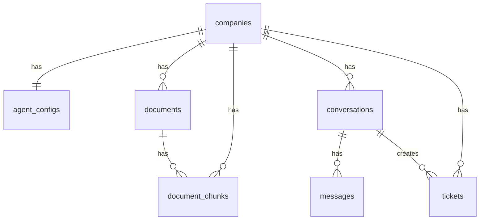

# Architettura

Panoramica dell'architettura tecnica di MDK Frontline: componenti principali, stack tecnologico e schema del database.

---

## 📋 Indice

- [📄 Panoramica](#-panoramica)
- [⚙️ Come funziona](#️-come-funziona)
- [🗄️ Schema del database](#️-schema-del-database)
- [🔒 Sicurezza e isolamento multi-tenant](#-sicurezza-e-isolamento-multi-tenant)
- [🔑 Autenticazione (SSO da MDK-137)](#-autenticazione-sso-da-mdk-137)
- [📚 Riferimenti](#-riferimenti)

---

## 📄 Panoramica

MDK Frontline è un SaaS multi-tenant di customer support AI. Ogni azienda cliente è un **tenant** isolato: i suoi documenti, le conversazioni e i ticket non sono mai visibili ad altri tenant.

Componenti principali:

- **Backend (Python + FastAPI)** — API REST, orchestratore dell'agente AI, sistema RAG, integrazione con Claude (Anthropic).
- **Frontend (Next.js + shadcn/ui)** — dashboard aziendale in inglese e pagina di live chat pubblica.
- **Database (Supabase)** — PostgreSQL con estensione `pgvector` per gli embedding, Supabase Storage per i file, Row Level Security per l'isolamento multi-tenant. Tutti gli oggetti applicativi vivono nello schema dedicato `frontline`; l'estensione `pgvector` vive nello schema dedicato `extensions`. Lo schema `public` è vuoto.
- **LLM esterno** — Anthropic Claude.

---

## ⚙️ Come funziona

```txt
[Cliente finale]
      │
      ▼  POST /chat/{slug}/message
[Live chat] ──► [Backend FastAPI]
                        │
                        ▼
               [SupportAgent loop]
                /       |        \
               ▼        ▼         ▼
        [search_    [create_   [escalate]
         knowledge]  ticket]
               \       |        /
                ▼       ▼       ▼
           [Supabase]       [Anthropic Claude]
        (DB + Storage       (tool calling,
          + pgvector)        claude-sonnet-5)
```

Il backend si connette a Supabase tramite **service role key** (chiave privata). Il service role **bypassa la Row Level Security**: l'isolamento tra tenant è garantito a livello applicativo, filtrando sempre per `company_id` nelle query.

### Loop dell'agente

1. Carica lo storico della conversazione dal DB.
2. Costruisce il system prompt da `agent_config` (nome agente, azienda, tono, lingua).
3. Chiama Claude con i tre tool definiti (`search_knowledge`, `create_ticket`, `escalate`).
4. Se Claude invoca un tool → lo esegue, invia il risultato a Claude, ripete.
5. Quando Claude produce una risposta finale (`stop_reason = "end_turn"`) → salva i messaggi nel DB e ritorna la risposta al client.

---

## 🗄️ Schema del database

Lo schema è definito da migration SQL in [backend/database/migrations/](../backend/database/migrations/). Vanno eseguite manualmente nel SQL Editor di Supabase **in ordine numerico**.

Tabelle, funzioni e view vivono in uno schema dedicato **`frontline`** (lo schema `public` resta libero per un futuro secondo prodotto). L'estensione `vector` (pgvector) vive in un secondo schema dedicato, **`extensions`**: `public` è quindi completamente vuoto. Il backend punta allo schema applicativo giusto tramite la variabile `SUPABASE_SCHEMA` (default `frontline`); lo schema `extensions` non è mai interrogato direttamente dal backend.

### Tabelle

| Tabella           | Scopo                                                                                           |
|-------------------|-------------------------------------------------------------------------------------------------|
| `companies`       | Aziende clienti (tenant). Ogni azienda ha uno `slug` usato nell'URL chat.                       |
| `agent_configs`   | Configurazione dell'agente per ogni azienda (nome, logo, tono, ecc.).                           |
| `documents`       | Documenti della knowledge base (metadata + riferimento allo Storage).                           |
| `document_chunks` | Pezzi di documento con embedding (vector 1024) per la ricerca semantica.                        |
| `conversations`   | Conversazioni della live chat. Status: `active`, `closed`, `escalated`.                         |
| `messages`        | Singoli messaggi dentro ogni conversazione (ruoli: `customer`, `agent`, `system`).              |
| `tickets`         | Ticket aperti dall'agente. `is_escalation=false` → supporto normale; `true` → escalation umana. |

### Diagramma ER



### Estensioni PostgreSQL

- `vector` (pgvector) — installata nello schema `extensions`, usata per la ricerca semantica (colonna `document_chunks.embedding`, vettori da 1024 dimensioni, indice HNSW con cosine distance).
- `pgcrypto` — usata per `gen_random_uuid()` nelle primary key.

### Storage

Il bucket Supabase `documents` è **privato**: solo il backend (service role) può leggere/scrivere. Gli oggetti sono organizzati come `<company_id>/<document_id>/<filename>` per separare i tenant e prevenire collisioni tra file con lo stesso nome.

---

## 🔒 Sicurezza e isolamento multi-tenant

- **Row Level Security (RLS)** attivata su tutte le tabelle. Nell'MVP non ci sono policy per `anon`/`authenticated` (quindi: nessun accesso diretto dal frontend al DB). Tutto il traffico passa dal backend, che usa il service role e bypassa RLS.
- **Isolamento applicativo**: ogni query backend filtra per `company_id`. Dashboard e documenti lo ricavano dal token di sessione Frontline (`Authorization: Bearer`); se l'header manca si usa `DEV_COMPANY_ID` (sviluppo locale). La live chat pubblica usa lo slug nell'URL.
- **Storage**: bucket privato, oggetti namespaciati per `company_id`.
- **Segreti**: `SUPABASE_SERVICE_ROLE_KEY` e `ANTHROPIC_API_KEY` vivono solo in `backend/.env`, mai esposti al frontend.

---

## 🔑 Autenticazione (SSO da MDK-137)

MDK Frontline **non gestisce login, registrazione o password**: queste responsabilità restano sul sito MDK-137. Frontline non ha una propria pagina di login: si fida di chi arriva con un JWT valido emesso dal sito.

### Flusso

1. L'azienda cliente effettua il login **su MDK-137** (dove ha già acquistato il prodotto).
2. Dal sito apre Frontline. MDK-137 reindirizza a `/sso/callback?sso_token=...` (JWT HS256, durata 60 secondi, `sub` = `company_id`, `jti` univoco, `product` = `mdk-frontline`).
3. Il frontend chiede al backend `POST /auth/sso`. Il backend verifica firma (`SSO_SHARED_SECRET`), issuer `mdk-137-website`, audience `mdk-frontline`, scadenza (leeway 10s), `jti` presente e `product` uguale a `mdk-frontline`. Poi registra il `jti` su Upstash Redis per 90 secondi: se è già presente risponde `401`; se Redis non risponde o le variabili mancano risponde `503` e non emette la sessione.
4. Il backend emette un token di sessione interno (24h, `FRONTLINE_SESSION_SECRET`, mai condiviso col sito). Il frontend lo salva nel cookie `frontline_session` con `httpOnly`: JavaScript non può leggerlo e il browser non allega `Authorization: Bearer`. Lo allega il proxy Next.js (`/api/...`) alle chiamate dashboard/documenti.
5. Token mancante, scaduto, già usato o non valido → pagina `/sso/error` con link di ritorno al sito. Se il controllo anti-riuso non è disponibile, la stessa pagina: il frontend tratta `401` e `503` allo stesso modo.

In locale, senza header di sessione, gli endpoint continuano a usare `DEV_COMPANY_ID`.

---

## 📚 Riferimenti

- **Migration SQL**: [backend/database/migrations/](../backend/database/migrations/)
- **Client Supabase**: [backend/database/supabase_client.py](../backend/database/supabase_client.py)
- **Modelli Pydantic**: [backend/database/models.py](../backend/database/models.py)
- **Test**: [backend/tests/database/](../backend/tests/database/)
- **SSO / sessione**: [backend/utils/auth.py](../backend/utils/auth.py), [backend/utils/replay_guard.py](../backend/utils/replay_guard.py), [backend/api/auth.py](../backend/api/auth.py)
- **Doc correlati**: [config.md](config.md), [repo_structure.md](repo_structure.md), [api_endpoints.md](api_endpoints.md)
- **Whiteboard di prodotto**: [dev_support/whiteboard.md](../dev_support/whiteboard.md)
