# Architecture

Technical overview of MDK Frontline: main components, technology stack, and database schema.

---

## 📋 Contents

- [📄 Overview](#-overview)
- [⚙️ How it works](#️-how-it-works)
- [🗄️ Database schema](#️-database-schema)
- [🔒 Multi-tenant security and isolation](#-multi-tenant-security-and-isolation)
- [🔑 Authentication (SSO from an external site)](#-authentication-sso-from-an-external-site)
- [📚 References](#-references)

---

## 📄 Overview

MDK Frontline is a multi-tenant AI customer-support SaaS. Each customer company is an isolated **tenant**: its documents, conversations, and tickets are never visible to other tenants.

Main components:

- **Backend (Python + FastAPI)** — REST API, AI agent orchestrator, RAG system, and the Claude (Anthropic) integration.
- **Frontend (Next.js + shadcn/ui)** — company dashboard in English and a public live chat page.
- **Database (Supabase)** — PostgreSQL with the `pgvector` extension for embeddings, Supabase Storage for files, and Row Level Security for multi-tenant isolation. All application objects live in the dedicated `frontline` schema; the `pgvector` extension lives in the dedicated `extensions` schema. The `public` schema is empty.
- **External LLM** — Anthropic Claude.

---

## ⚙️ How it works

```txt
[End customer]
      │
      ▼  POST /chat/{slug}/message
[Live chat] ──► [FastAPI backend]
                        │
                        ▼
               [SupportAgent loop]
                /       |        \
               ▼        ▼         ▼
        [search_    [create_   [escalate]
         knowledge]  ticket]
               \       |        /
                ▼       ▼       ▼
           [Supabase]       [Anthropic Claude]
        (DB + Storage       (tool calling,
          + pgvector)        claude-sonnet-5)
```

The backend connects to Supabase with the **service role key** (a private key). The service role **bypasses Row Level Security**: tenant isolation is enforced in application code, by filtering every query on `company_id`.

### Agent loop

1. Load the conversation history from the database.
2. Build the system prompt from `agent_config` (agent name, company, tone, language).
3. Call Claude with the three defined tools (`search_knowledge`, `create_ticket`, `escalate`).
4. If Claude calls a tool, run it, send the result back to Claude, and repeat.
5. When Claude produces a final answer (`stop_reason = "end_turn"`), save the messages to the database and return the answer to the client.

---

## 🗄️ Database schema

The schema is defined by SQL migrations in [backend/database/migrations/](../backend/database/migrations/). Run them manually in the Supabase SQL Editor, **in numeric order**.

Tables, functions, and views live in a dedicated **`frontline`** schema (the `public` schema is left free for a possible second product later). The `vector` extension (pgvector) lives in a second dedicated schema, **`extensions`**, so `public` is completely empty. The backend selects the application schema through the `SUPABASE_SCHEMA` variable (default `frontline`). The backend never queries the `extensions` schema directly.

### Tables

| Table             | Purpose                                                                                                      |
|-------------------|--------------------------------------------------------------------------------------------------------------|
| `companies`       | Customer companies (tenants). Each company has a `slug` used in the chat URL.                                |
| `agent_configs`   | Agent configuration for each company (name, logo, tone, and so on).                                          |
| `documents`       | Knowledge-base documents (metadata plus a reference to Storage).                                             |
| `document_chunks` | Document chunks with an embedding (1024-dimension vector) for semantic search.                               |
| `conversations`   | Live chat conversations. Status: `active`, `closed`, `escalated`.                                            |
| `messages`        | Individual messages inside a conversation (roles: `customer`, `agent`, `system`).                            |
| `tickets`         | Tickets opened by the agent. `is_escalation=false` is a normal support ticket; `true` is a human escalation. |

### ER diagram

```mermaid
erDiagram
    companies ||--|| agent_configs : has
    companies ||--o{ documents : has
    documents ||--o{ document_chunks : has
    companies ||--o{ document_chunks : has
    companies ||--o{ conversations : has
    companies ||--o{ tickets : has
    conversations ||--o{ messages : has
    conversations ||--o{ tickets : creates
```



### PostgreSQL extensions

- `vector` (pgvector) — installed in the `extensions` schema and used for semantic search (the `document_chunks.embedding` column, 1024-dimension vectors, HNSW index with cosine distance).
- `pgcrypto` — used for `gen_random_uuid()` on primary keys.

### Storage

The Supabase `documents` bucket is **private**: only the backend (service role) can read and write. Objects are stored as `<company_id>/<document_id>/<filename>`, which separates tenants and avoids collisions between files that share a name.

---

## 🔒 Multi-tenant security and isolation

- **Row Level Security (RLS)** is enabled on every table. The MVP has no policies for `anon` or `authenticated`, so the frontend cannot reach the database directly. All traffic goes through the backend, which uses the service role and bypasses RLS.
- **Application isolation**: every backend query filters on `company_id`. Dashboard and document routes take it from the Frontline session token (`Authorization: Bearer`). If the header is missing the response is `401`, unless `ALLOW_DEV_COMPANY_FALLBACK=true` in local development, in which case `DEV_COMPANY_ID` is used. The public live chat uses the slug in the URL.
- **Storage**: private bucket, objects namespaced by `company_id`.
- **Secrets**: `SUPABASE_SERVICE_ROLE_KEY` and `ANTHROPIC_API_KEY` live only in `backend/.env` and are never exposed to the frontend.

---

## 🔑 Authentication (SSO from an external site)

The dashboard has no login of its own. It opens with a JWT signed by an external site, exchanged at `POST /auth/sso` for an internal session.

### Flow

1. The customer company signs in **on the external site**.
2. From that site they open Frontline. The external site redirects to `/sso/callback?sso_token=...` (HS256 JWT, valid for 60 seconds, `sub` = `company_id`, a unique `jti`, `product` = `mdk-frontline`).
3. The frontend calls `POST /auth/sso`. The backend checks the signature (`SSO_SHARED_SECRET`), issuer `mdk-137-website`, audience `mdk-frontline`, expiry (10-second leeway), that `jti` is present, and that `product` equals `mdk-frontline`. It then stores the `jti` in Upstash Redis for 90 seconds. If the `jti` is already there, the response is `401`. If Redis does not respond, or the variables are missing, the response is `503` and no session is issued.
4. The backend issues an internal session token (24 hours, `FRONTLINE_SESSION_SECRET`, never shared with the site). The frontend stores it in the `frontline_session` cookie with `httpOnly`: JavaScript cannot read it, and the browser does not attach `Authorization: Bearer`. The Next.js proxy (`/api/...`) attaches it on dashboard and document calls. On `POST`, `PATCH`, and `DELETE`, the proxy returns `403` if the origin does not match the site host.
5. A missing, expired, already used, or invalid token leads to the `/sso/error` page, with a link back to the site when that URL is configured. If the replay check is unavailable, the same page is shown: the frontend treats `401` and `503` the same way.

Locally, without a session header, endpoints use `DEV_COMPANY_ID` only when `ALLOW_DEV_COMPANY_FALLBACK=true`. Without that flag they return `401`.

---

## 📚 References

- **SQL migrations**: [backend/database/migrations/](../backend/database/migrations/)
- **Supabase client**: [backend/database/supabase_client.py](../backend/database/supabase_client.py)
- **Pydantic models**: [backend/database/models.py](../backend/database/models.py)
- **Tests**: [backend/tests/database/](../backend/tests/database/)
- **SSO / session**: [backend/utils/auth.py](../backend/utils/auth.py), [backend/utils/replay_guard.py](../backend/utils/replay_guard.py), [backend/api/auth.py](../backend/api/auth.py)
- **Related docs**: [config.md](config.md), [repo_structure.md](repo_structure.md), [api_endpoints.md](api_endpoints.md)
- **Product whiteboard**: [dev_support/whiteboard.md](../dev_support/whiteboard.md)
