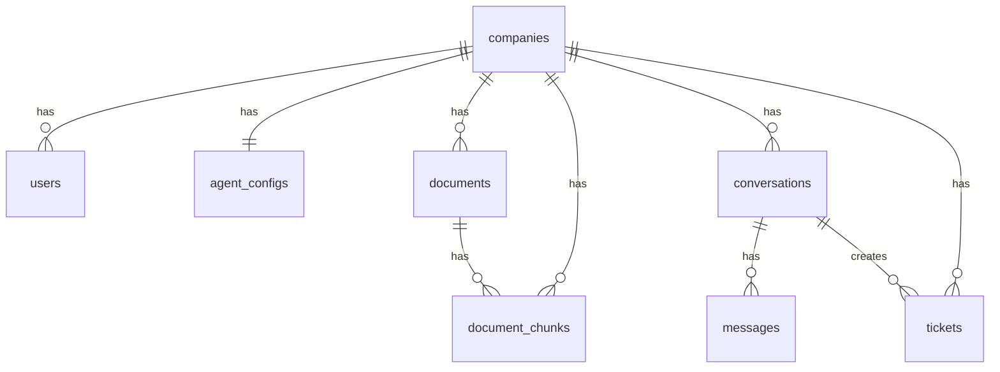

# Architettura

Panoramica dell'architettura tecnica di MDK Frontline: componenti principali, stack tecnologico e schema del database.

---

## 📋 Indice

- [📄 Panoramica](#-panoramica)
- [⚙️ Come funziona](#️-come-funziona)
- [🗄️ Schema del database](#️-schema-del-database)
- [🔒 Sicurezza e isolamento multi-tenant](#-sicurezza-e-isolamento-multi-tenant)
- [📚 Riferimenti](#-riferimenti)

---

## 📄 Panoramica

MDK Frontline è un SaaS multi-tenant di customer support AI. Ogni azienda cliente è un **tenant** isolato: i suoi documenti, le conversazioni e i ticket non sono mai visibili ad altri tenant.

Componenti principali:

- **Backend (Python + FastAPI)** — API REST, orchestratore dell'agente AI, sistema RAG, integrazione con Claude (Anthropic).
- **Frontend (Next.js + shadcn/ui)** — dashboard aziendale in inglese e pagina di live chat pubblica.
- **Database (Supabase)** — PostgreSQL con estensione `pgvector` per gli embedding, Supabase Storage per i file, Row Level Security per l'isolamento multi-tenant.
- **LLM esterno** — Anthropic Claude.

---

## ⚙️ Come funziona

```txt
[Cliente finale]
      │
      ▼
[Live chat] ──► [Backend FastAPI] ──► [Agente AI + Tool (Knowledge / Ticket / Escalation)]
                        │                        │
                        ▼                        ▼
                   [Supabase]               [Anthropic Claude]
                 (DB + Storage + pgvector)
```

Il backend si connette a Supabase tramite **service role key** (chiave privata). Il service role **bypassa la Row Level Security**: l'isolamento tra tenant è garantito a livello applicativo, filtrando sempre per `company_id` nelle query.

---

## 🗄️ Schema del database

Lo schema è definito da migration SQL in [backend/database/migrations/](../backend/database/migrations/). Vanno eseguite manualmente nel SQL Editor di Supabase **in ordine numerico**.

### Tabelle

| Tabella          | Scopo                                                                       |
|------------------|-----------------------------------------------------------------------------|
| `companies`      | Aziende clienti (tenant). Ogni azienda ha uno `slug` usato nell'URL chat.   |
| `users`          | Utenti della dashboard (MVP: minimale, predisposta per il futuro).          |
| `agent_configs`  | Configurazione dell'agente per ogni azienda (nome, logo, tono, ecc.).       |
| `documents`      | Documenti della knowledge base (metadata + riferimento allo Storage).       |
| `document_chunks`| Pezzi di documento con embedding (vector 1024) per la ricerca semantica.    |
| `conversations`  | Conversazioni della live chat.                                              |
| `messages`       | Singoli messaggi dentro ogni conversazione.                                 |
| `tickets`        | Ticket aperti dall'agente (casi non risolvibili o escalation).              |

### Diagramma ER



### Estensioni PostgreSQL

- `vector` (pgvector) — usata per la ricerca semantica (colonna `document_chunks.embedding`, vettori da 1024 dimensioni, indice HNSW con cosine distance).
- `pgcrypto` — usata per `gen_random_uuid()` nelle primary key.

### Storage

Il bucket Supabase `documents` è **privato**: solo il backend (service role) può leggere/scrivere. Gli oggetti sono organizzati come `<company_id>/<filename>` per separare i tenant anche a livello di file system.

---

## 🔒 Sicurezza e isolamento multi-tenant

- **Row Level Security (RLS)** attivata su tutte le tabelle. Nell'MVP non ci sono policy per `anon`/`authenticated` (quindi: nessun accesso diretto dal frontend al DB). Tutto il traffico passa dal backend, che usa il service role e bypassa RLS.
- **Isolamento applicativo**: ogni query backend filtra per `company_id` (nell'MVP identificato dalla variabile `DEV_COMPANY_ID`). In fase successiva l'identità reale arriverà dall'integrazione auth con MDK-137.
- **Storage**: bucket privato, oggetti namespaciati per `company_id`.
- **Segreti**: `SUPABASE_SERVICE_ROLE_KEY` e `ANTHROPIC_API_KEY` vivono solo in `backend/.env`, mai esposti al frontend.

---

## 📚 Riferimenti

- **Migration SQL**: [backend/database/migrations/](../backend/database/migrations/)
- **Client Supabase**: [backend/database/supabase_client.py](../backend/database/supabase_client.py)
- **Modelli Pydantic**: [backend/database/models.py](../backend/database/models.py)
- **Test**: [backend/tests/database/](../backend/tests/database/)
- **Doc correlati**: [config.md](config.md), [repo_structure.md](repo_structure.md)
- **Whiteboard di prodotto**: [dev_support/whiteboard.md](../dev_support/whiteboard.md)
