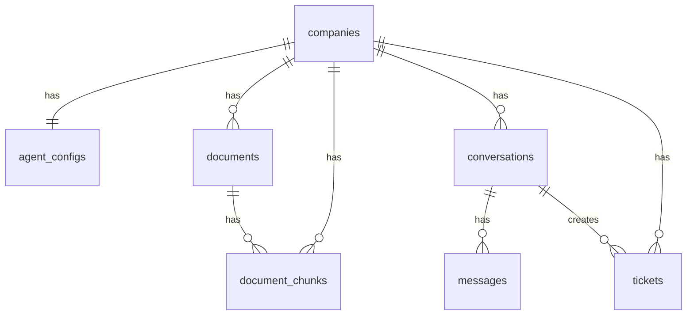
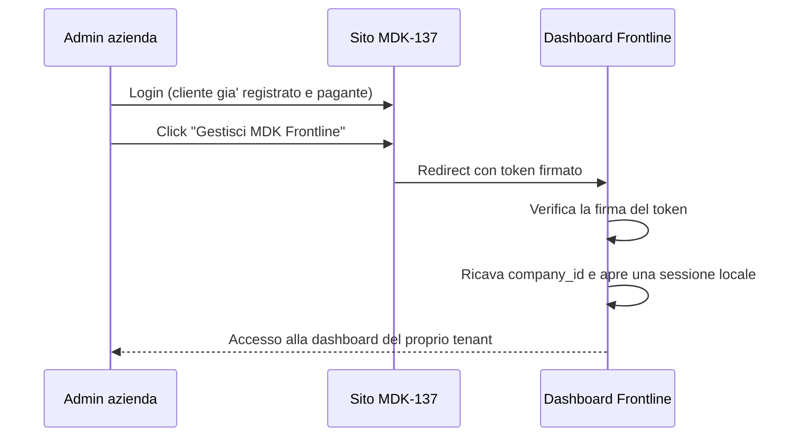

# Architettura

Panoramica dell'architettura tecnica di MDK Frontline: componenti principali, stack tecnologico e schema del database.

---

## 📋 Indice

- [📄 Panoramica](#-panoramica)
- [⚙️ Come funziona](#️-come-funziona)
- [🗄️ Schema del database](#️-schema-del-database)
- [🔒 Sicurezza e isolamento multi-tenant](#-sicurezza-e-isolamento-multi-tenant)
- [🔑 Autenticazione (pianificata)](#-autenticazione-pianificata)
- [📚 Riferimenti](#-riferimenti)

---

## 📄 Panoramica

MDK Frontline è un SaaS multi-tenant di customer support AI. Ogni azienda cliente è un **tenant** isolato: i suoi documenti, le conversazioni e i ticket non sono mai visibili ad altri tenant.

Componenti principali:

- **Backend (Python + FastAPI)** — API REST, orchestratore dell'agente AI, sistema RAG, integrazione con Claude (Anthropic).
- **Frontend (Next.js + shadcn/ui)** — dashboard aziendale in inglese e pagina di live chat pubblica.
- **Database (Supabase)** — PostgreSQL con estensione `pgvector` per gli embedding, Supabase Storage per i file, Row Level Security per l'isolamento multi-tenant. Tutti gli oggetti applicativi vivono nello schema dedicato `frontline`; l'estensione `pgvector` vive nello schema dedicato `extensions`. Lo schema `public` è vuoto.
- **LLM esterno** — Anthropic Claude.

---

## ⚙️ Come funziona

```txt
[Cliente finale]
      │
      ▼  POST /chat/{slug}/message
[Live chat] ──► [Backend FastAPI]
                        │
                        ▼
               [SupportAgent loop]
                /       |        \
               ▼        ▼         ▼
        [search_    [create_   [escalate]
         knowledge]  ticket]
               \       |        /
                ▼       ▼       ▼
           [Supabase]       [Anthropic Claude]
        (DB + Storage       (tool calling,
          + pgvector)        claude-sonnet-5)
```

Il backend si connette a Supabase tramite **service role key** (chiave privata). Il service role **bypassa la Row Level Security**: l'isolamento tra tenant è garantito a livello applicativo, filtrando sempre per `company_id` nelle query.

### Loop dell'agente

1. Carica lo storico della conversazione dal DB.
2. Costruisce il system prompt da `agent_config` (nome agente, azienda, tono, lingua).
3. Chiama Claude con i tre tool definiti (`search_knowledge`, `create_ticket`, `escalate`).
4. Se Claude invoca un tool → lo esegue, invia il risultato a Claude, ripete.
5. Quando Claude produce una risposta finale (`stop_reason = "end_turn"`) → salva i messaggi nel DB e ritorna la risposta al client.

---

## 🗄️ Schema del database

Lo schema è definito da migration SQL in [backend/database/migrations/](../backend/database/migrations/). Vanno eseguite manualmente nel SQL Editor di Supabase **in ordine numerico**.

Tabelle, funzioni e view vivono in uno schema dedicato **`frontline`** (lo schema `public` resta libero per un futuro secondo prodotto). L'estensione `vector` (pgvector) vive in un secondo schema dedicato, **`extensions`**: `public` è quindi completamente vuoto. Il backend punta allo schema applicativo giusto tramite la variabile `SUPABASE_SCHEMA` (default `frontline`); lo schema `extensions` non è mai interrogato direttamente dal backend.

### Tabelle

| Tabella           | Scopo                                                                                           |
|-------------------|-------------------------------------------------------------------------------------------------|
| `companies`       | Aziende clienti (tenant). Ogni azienda ha uno `slug` usato nell'URL chat.                       |
| `agent_configs`   | Configurazione dell'agente per ogni azienda (nome, logo, tono, ecc.).                           |
| `documents`       | Documenti della knowledge base (metadata + riferimento allo Storage).                           |
| `document_chunks` | Pezzi di documento con embedding (vector 1024) per la ricerca semantica.                        |
| `conversations`   | Conversazioni della live chat. Status: `active`, `closed`, `escalated`.                         |
| `messages`        | Singoli messaggi dentro ogni conversazione (ruoli: `customer`, `agent`, `system`).              |
| `tickets`         | Ticket aperti dall'agente. `is_escalation=false` → supporto normale; `true` → escalation umana. |

### Diagramma ER



### Estensioni PostgreSQL

- `vector` (pgvector) — installata nello schema `extensions`, usata per la ricerca semantica (colonna `document_chunks.embedding`, vettori da 1024 dimensioni, indice HNSW con cosine distance).
- `pgcrypto` — usata per `gen_random_uuid()` nelle primary key.

### Storage

Il bucket Supabase `documents` è **privato**: solo il backend (service role) può leggere/scrivere. Gli oggetti sono organizzati come `<company_id>/<document_id>/<filename>` per separare i tenant e prevenire collisioni tra file con lo stesso nome.

---

## 🔒 Sicurezza e isolamento multi-tenant

- **Row Level Security (RLS)** attivata su tutte le tabelle. Nell'MVP non ci sono policy per `anon`/`authenticated` (quindi: nessun accesso diretto dal frontend al DB). Tutto il traffico passa dal backend, che usa il service role e bypassa RLS.
- **Isolamento applicativo**: ogni query backend filtra per `company_id` (nell'MVP identificato dalla variabile `DEV_COMPANY_ID`). In fase successiva l'identità reale arriverà dall'integrazione auth con MDK-137 (vedi [Autenticazione (pianificata)](#-autenticazione-pianificata)).
- **Storage**: bucket privato, oggetti namespaciati per `company_id`.
- **Segreti**: `SUPABASE_SERVICE_ROLE_KEY` e `ANTHROPIC_API_KEY` vivono solo in `backend/.env`, mai esposti al frontend.

---

## 🔑 Autenticazione (pianificata)

> Funzionalità non ancora implementata. Questa sezione descrive la direzione di progetto, non lo stato attuale (nell'MVP la dashboard usa `DEV_COMPANY_ID` e non ha autenticazione).

MDK Frontline **non gestisce login, registrazione o password**: queste responsabilità restano sul sito MDK-137, che funge da fornitore d'identità centrale. Frontline non costruisce una propria pagina di login, ma si **fida** di chi arriva con una prova d'identità valida emessa da MDK-137.

### Flusso previsto



1. L'azienda cliente effettua il login **su MDK-137** (dove ha già acquistato il prodotto).
2. Dalla propria area su MDK-137 apre la gestione di MDK Frontline.
3. MDK-137 reindirizza alla dashboard di Frontline passando un **token firmato** (non falsificabile) che attesta l'identità dell'azienda.
4. Frontline **verifica la firma** del token, ne ricava il `company_id` reale e apre una propria sessione.
5. Da quel momento le query usano il `company_id` autenticato **al posto di** `DEV_COMPANY_ID`.

### Impatto sul codice attuale

Il punto di sostituzione è unico e già isolato: oggi il tenant è la costante `DEV_COMPANY_ID` ([backend/utils/config.py](../backend/utils/config.py)), usata dagli endpoint `/dashboard/*`. L'autenticazione la rimpiazzerà con l'identità ricavata dal token, senza toccare la logica di business sottostante.

### Decisioni da definire al momento dell'implementazione

- **Formato del token** (es. JWT) e claim minimi necessari (almeno l'identità dell'azienda).
- **Meccanismo di fiducia** tra i due sistemi: segreto condiviso (firma simmetrica) oppure chiave pubblica/privata (firma asimmetrica).
- **Durata e rinnovo** del token, e come Frontline mantiene la sessione dopo il primo redirect.
- **Comportamento in caso di token assente, scaduto o non valido** (es. redirect verso MDK-137).

Questi dettagli vanno concordati con il lato MDK-137 quando i due progetti verranno integrati.

---

## 📚 Riferimenti

- **Migration SQL**: [backend/database/migrations/](../backend/database/migrations/)
- **Client Supabase**: [backend/database/supabase_client.py](../backend/database/supabase_client.py)
- **Modelli Pydantic**: [backend/database/models.py](../backend/database/models.py)
- **Test**: [backend/tests/database/](../backend/tests/database/)
- **Doc correlati**: [config.md](config.md), [repo_structure.md](repo_structure.md)
- **Whiteboard di prodotto**: [dev_support/whiteboard.md](../dev_support/whiteboard.md)
